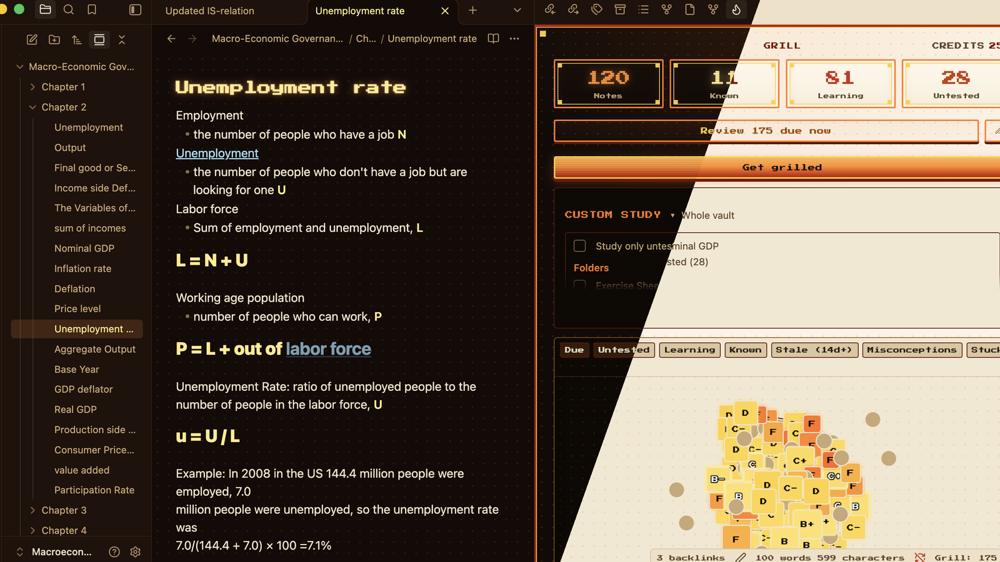
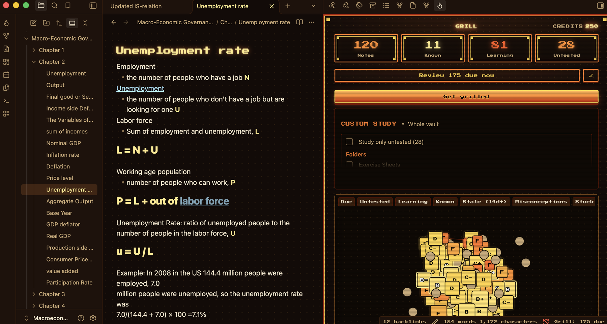
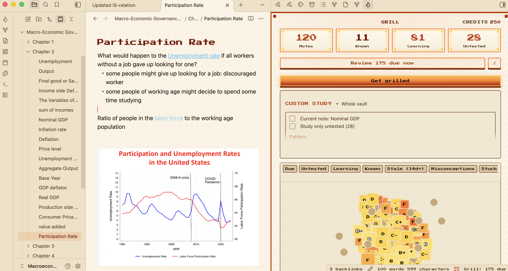
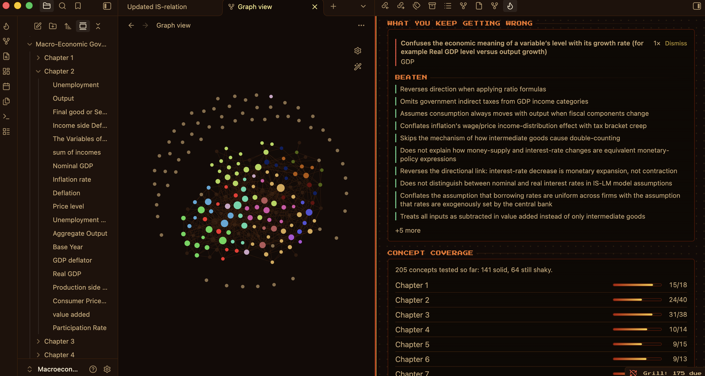
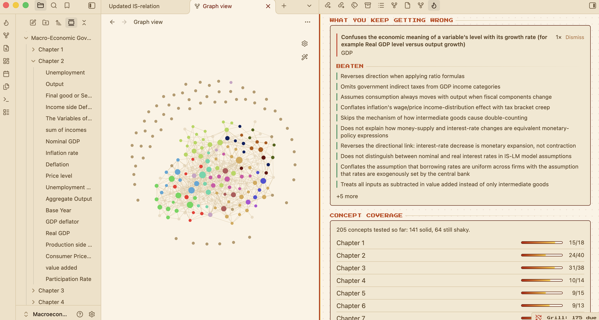
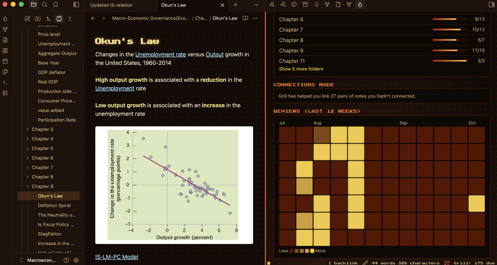

Grill is an [Obsidian](https://obsidian.md) theme. It's a minimal extension of the arcade look of the [Grill plugin](https://community.obsidian.md/plugins/grill), which quizzes you on your own notes.

I made it to complement the plugin. The note you study from and the pane that grills you on it sit together as one thing. It comes in dark and light, and it works without the plugin too.

## Screenshots

**Dark** is the cabinet: near-black, ember orange and gold.

**Light** is the same cabinet with the lights on. Warm paper, ember ink.

**Obsidian's graph** sits on the same ground as Grill's progress screen, in both modes.

**Your review history** is drawn in the colours of your notes.

## Installation

To install the theme

- Open Obsidian Settings
- Go to Appearance and press Manage
- Search for Grill and press Install and use

To install the plugin

- Go to Community plugins and turn off Restricted mode
- Press Browse and search for Grill
- Press Install, then Enable

To install the theme by hand, download `theme.css` and `manifest.json` from the [latest release](https://github.com/theadamdanielsson/grill-theme/releases/latest) into `.obsidian/themes/Grill/` in your vault, then pick Grill under Appearance.

## The Grill plugin

[Grill](https://community.obsidian.md/plugins/grill) writes questions from your notes, marks what you type back, and colours in a map of what you know. You can start free, with no API key and no sign-up. I recommend it to anyone who uses this theme, because the theme was drawn around it.

- [Grill in Community plugins](https://community.obsidian.md/plugins/grill)
- [Grill on GitHub](https://github.com/theadamdanielsson/grill)
- [grill.onbridger.com](https://grill.onbridger.com)

With this theme on, Grill follows your light or dark mode. On every other theme its screens stay dark. That needs Grill 7.1.1 or later.

## What it changes

Your notes stay in the font you chose. A note's title and its top-level headings are set in pixel lettering. Headings are gold, links and buttons are orange, and bold text is lit.

Most of the theme is Obsidian's own colour, font and corner settings. Four small things are styled by name: the dot grid under a note, the glow on a title, the status bar and the main button of a dialog. Other plugins are left as they are. If you pick your own accent colour in Appearance, that wins.

## Feedback

Bugs go to [issues](https://github.com/theadamdanielsson/grill-theme/issues). If you like the theme, you can [buy me a coffee](https://buymeacoffee.com/grill).

## Credits

The pixel font is Press Start 2P by CodeMan38, under the [SIL Open Font License](fonts/PressStart2P-OFL.txt). The theme is under the [MIT License](LICENSE).
